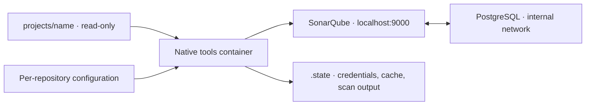

# Local PHP and Python SonarQube package

Clone PHP, Python, or mixed repositories into `projects/`, run a scan, and open the printed SonarQube dashboard. Each repository has its own private project and analysis history.

The package runs SonarQube Community Build, PostgreSQL, and a native one-shot scanner with Docker Compose or Podman Compose. Docker is the default; select Podman explicitly with `--engine podman` or `SONAR_ENGINE=podman`. Setup, administrator password rotation, project registration, and scan tokens are automated.

## Requirements

- macOS or Linux, on Intel/AMD64 or ARM64, with a **local** container engine.
- Bash and Git, plus either Docker with the Docker Compose v2-or-newer plugin, or Podman with `podman compose` and an external Compose provider.
- Docker Desktop / Podman machine running on macOS, or Docker Engine / Podman running on Linux.
- Recommended: allocate **8 GB RAM**, at least **2 CPUs**, and **30 GB available disk** to the selected engine. Keep at least 10% of its disk free. Requirements grow with repository size.
- Network access for container images, the verified scanner download, and Ubuntu packages during the first tools build.

Using this package requires no host PHP, Composer, PHPUnit, Java, or Python installation. The tools container includes Java and Python; your existing test environment remains responsible for PHPUnit, pytest, and coverage generation. Python 3.8+ is only needed if you run the maintainer tests locally.

### Linux and container VM prerequisites

SonarQube's embedded Elasticsearch requires `vm.max_map_count >= 524288`, `fs.file-max >= 131072`, and suitable process/file limits. Compose supplies `nofile=131072` and `nproc=8192` for the server container. Startup checks the kernel values before starting services. The package does not change kernel settings or disable Elasticsearch bootstrap checks.

Check the Linux container host:

```bash
sysctl vm.max_map_count fs.file-max
```

When the current values are below the requirements, set them on that host:

```bash
sudo sysctl -w vm.max_map_count=524288
sudo sysctl -w fs.file-max=131072
```

For persistence across Linux reboots, put those values in `/etc/sysctl.d/99-sonarqube.conf` and apply that file with `sudo sysctl -p /etc/sysctl.d/99-sonarqube.conf`.

On macOS these settings belong to **Docker's Linux VM**. After a first startup attempt has built the tools image, inspect them with:

```bash
SONAR_TOOLS_IMAGE="$(cat .state/stack-name)-tools"
docker run --rm --entrypoint python3 "$SONAR_TOOLS_IMAGE" \
  -c 'from pathlib import Path; print(Path("/proc/sys/vm/max_map_count").read_text()); print(Path("/proc/sys/fs/file-max").read_text())'
```

If needed, set the VM's map count explicitly using a temporary privileged container:

```bash
docker run --rm --privileged --user 0:0 --entrypoint python3 "$SONAR_TOOLS_IMAGE" \
  -c 'from pathlib import Path; Path("/proc/sys/vm/max_map_count").write_text("524288\n")'
```

Docker Desktop may reset this setting after restarting its VM, including an idle VM restart through Resource Saver. Record the original value before changing it. See the [SonarQube host requirements](https://docs.sonarsource.com/sonarqube-community-build/server-installation/server-host-requirements) and [Linux prerequisites](https://docs.sonarsource.com/sonarqube-community-build/server-installation/pre-installation/linux).

For a macOS Podman machine, inspect and set the values **inside that VM** (replace the name if using a custom machine):

```bash
podman machine ssh podman-machine-default sysctl vm.max_map_count fs.file-max
podman machine ssh podman-machine-default sudo sysctl -w vm.max_map_count=524288
```

Set `fs.file-max=131072` inside the VM only if its existing value is lower. For persistence, use the same `/etc/sysctl.d/99-sonarqube.conf` approach inside the VM. A rootless privileged container cannot change the VM's host kernel settings. The package only checks prerequisites; it does not alter them.

### Selecting Podman

```bash
./sonar --engine podman scan my-app
./sonar --engine podman report my-app
./sonar --engine podman credentials
./sonar --engine podman down
```

The global option precedes the command. `--engine=podman` also works. To select it for a shell session:

```bash
export SONAR_ENGINE=podman
./sonar scan my-app
```

An explicit `--engine docker` overrides the environment. All commands, including logs, status, reset, and credentials, use the selected engine; there is no automatic fallback to another engine.

Podman's `compose` command delegates to an installed provider, such as `docker-compose` or `podman-compose`. Use `podman compose version` to check it. `PODMAN_COMPOSE_PROVIDER` can select the provider executable, for example `PODMAN_COMPOSE_PROVIDER=podman-compose`. Installing the Docker Compose CLI as a provider does not require running Docker's daemon. [Podman Compose documentation](https://docs.podman.io/en/latest/markdown/podman-compose.1.html)

On macOS, initialize a machine if needed, then start it:

```bash
podman machine init --cpus 2 --memory 8192 --disk-size 30
podman machine start
```

Ensure the package folder is shared with that machine. Podman supports custom machines via `CONTAINER_CONNECTION`. Remote hosts are unsupported because source bind mounts and dashboard URLs refer to this computer. On Linux, a Docker Compose provider needs access to Podman's API socket; for rootless installations, `systemctl --user start podman.socket` makes that socket available. A `podman-compose` provider invokes Podman directly.

Docker retains its existing `.state/` layout and named volumes. Podman uses `.state/podman/`, its own Compose project name, and its own volumes. Analysis history and credentials are separate; selecting another engine does not migrate them. Both engines share the read-only `projects/` and `config/` folders and the package operation lock. Reset affects only the selected engine's data, including its exported reports.

Both stacks use port 9000 by default. To run them together, select another port for one stack and keep that port value for its later commands:

```bash
SONAR_PORT=9001 ./sonar --engine podman scan my-app
SONAR_PORT=9001 ./sonar --engine podman report my-app
```

Rootless Podman maps the invoking user's ID into the tools container using `keep-id`, so restricted state files stay writable. The Podman tools override disables SELinux label separation only for that one-shot container, leaving cloned repositories' host labels and ownership unchanged; source/config mounts remain read-only. Server containers retain their normal security defaults. The package does not recursively chown or relabel repositories. [Podman user namespaces and mounts](https://docs.podman.io/en/latest/markdown/podman-run.1.html)

## Quick start

Run these commands from this package folder:

```bash
git clone <repository-url> projects/my-app
./sonar scan my-app
./sonar credentials
```

The first scan builds the native tools image, downloads the pinned server/database images, starts the stack, and waits for SonarQube. It then creates a private project, scans the current working tree, waits for server processing, and prints the results URL and quality gate status.

Open [http://localhost:9000](http://localhost:9000) and sign in using the generated login shown by `./sonar credentials`. The initial `admin/admin` password is replaced automatically. The UI is bound to the local machine's loopback interface.

Repository folders must start with a letter or digit and contain only letters, digits, dots, underscores, or dashes. The package accepts up to 200 characters. Match the folder's capitalization exactly when scanning. Folder names determine project keys: `my-app` becomes `local:my-app`. Renaming a folder creates a different project/history.

Scans use the current local checkout, including uncommitted edits. The package preserves Git metadata and does not pull or switch branches. Community Build gives each project one analysis timeline; scanning another checkout updates that same timeline. [Edition comparison](https://docs.sonarsource.com/sonarqube-community-build/feature-comparison-table)

## Commands

| Command | Behavior |
| --- | --- |
| `./sonar up` | Start and initialize the stack without scanning. |
| `./sonar scan my-app` | Analyze one repository and report its gate status. |
| `./sonar scan my-app --path /path/to/checkout` | Analyze an external local checkout read-only, including current edits. |
| `./sonar scan --all` | Analyze every repository sequentially. |
| `./sonar scan my-app --check-gate` | Analyze, then fail the command if the gate does not pass. |
| `./sonar scan --all --check-gate` | Apply gate enforcement to every repository. |
| `./sonar report my-app` | Export the latest completed analysis as an HTML summary and CSV findings. |
| `./sonar status` | Show Compose services and server readiness. |
| `./sonar logs` | Show the latest 100 service log lines. |
| `./sonar logs sonarqube` | Show only SonarQube logs. `postgres` also works. |
| `./sonar credentials` | Display the generated local UI username and password. |
| `./sonar down` | Remove service containers while preserving data volumes and local state. |
| `./sonar reset --yes` | Remove the selected engine's containers, volumes, and generated state; preserve repositories/configuration and the other engine's data. |
| `./sonar help` | Show command help. |

Exit statuses: `0` means completed successfully; `1` means a configuration, scanner, or server error; `2` means a completed analysis failed gate enforcement. A failed gate still publishes results. Without `--check-gate`, gate failure is informational. For `--all`, runtime errors in one project do not prevent the remaining projects from scanning; any runtime error takes precedence over gate failures.

Operations are serialized. If another command is running, finish it before starting a new one. Stale locks with a dead owner are recovered automatically.

### External checkouts

```bash
./sonar scan external-app --path /absolute/path/to/application
./sonar report external-app
```

Relative paths are resolved from the invoking shell's working directory and canonicalized. External scans require one logical name and cannot use `--all`. That name selects `config/projects/<name>.properties` and project `local:<name>`; it cannot shadow a folder in `projects/` or a previously registered different source. The canonical host path is bound to the project in private state. Existing folder-based projects keep their identity and credentials format.

Only the selected checkout is mounted at `/external-project`, read-only; other package clones are hidden for this operation. Nothing is copied into `projects/`, and scanner output remains in `.state/`. Relative source/report paths are resolved within the external checkout; absolute paths embedded in imported XML must match `/external-project/`. Ensure the source path is shared with the selected engine VM.

Linked Git worktrees/submodule checkouts can have Git metadata outside this mount. To scan them without mounting or modifying that metadata, set these properties for the logical project:

```properties
sonar.scm.disabled=true
sonar.scm.exclusions.disabled=true
```

Code analysis and coverage imports still work, but blame and SCM-derived new-code detection are unavailable. Configured exclusions replace Git-ignore filtering in this mode, so retain dependency/cache exclusions and select owned code explicitly.

### Codex skill: sq

The reusable [sq skill](skills/codex/sq/SKILL.md) handles installation discovery, engine choice, prerequisites, scope configuration, scans, reports, and recovery. Install it personally from this repository (run from the package root):

```bash
SQ_SKILLS_DIR="${CODEX_HOME:-$HOME/.codex}/skills"
mkdir -p "$SQ_SKILLS_DIR"
if [ ! -e "$SQ_SKILLS_DIR/sq" ] && [ ! -L "$SQ_SKILLS_DIR/sq" ]; then
  ln -s "$PWD/skills/codex/sq" "$SQ_SKILLS_DIR/sq"
else
  printf 'Existing sq entry preserved: %s\n' "$SQ_SKILLS_DIR/sq"
fi
```

Use another destination by setting `SQ_SKILLS_DIR` appropriately before creating the directory/link. Inspect any existing `sq` entry before installation; do not replace an unrelated skill. The symlink keeps the skill aligned with this checkout. Codex's skill installer can also install the `skills/codex/sq` folder from this repository; a copied installation locates or provisions its package separately.

Invoke `$sq` with requests such as “analyze this checkout,” “set up local SonarQube,” or “export the latest report.” It asks for an engine on first setup and remembers it, alongside engine-specific ports, in Git-ignored `config/sq.local.properties`. `SQ_PACKAGE_ROOT` explicitly selects a package installation. The skill supplies those settings to the wrapper; the wrapper's default remains Docker.

Ordinary analysis imports existing reports and returns HTML/CSV plus findings without changing application code or running its tests. Worktrees are scanned without SCM blame. Separate external checkouts receive stable path-derived names through `skills/codex/sq/scripts/project-name.sh`. The read-only `doctor.sh` checks prerequisites: exit `0` checked, `1` blockers, `2` invalid usage, `3` required checks unverified. Actual package preflight/source validation remains authoritative.

### GitHub Copilot skill: sq

The [Copilot sq skill](skills/copilot/sq/SKILL.md) ports the same setup, scan, report, and recovery workflow to Copilot CLI and VS Code agent mode. It bundles its own helpers/references and uses Copilot's standard `SKILL.md` format. See [Copilot installation and access](skills/copilot/sq/references/copilot.md) for discovery, directory permissions, and remote/cloud session limitations.

Install the complete folder personally from the package root:

```bash
SQ_COPILOT_SKILLS_DIR="$HOME/.copilot/skills"
mkdir -p "$SQ_COPILOT_SKILLS_DIR"
if [ ! -e "$SQ_COPILOT_SKILLS_DIR/sq" ] && [ ! -L "$SQ_COPILOT_SKILLS_DIR/sq" ]; then
  cp -R "$PWD/skills/copilot/sq" "$SQ_COPILOT_SKILLS_DIR/sq"
else
  printf 'Existing sq entry preserved: %s\n' "$SQ_COPILOT_SKILLS_DIR/sq"
fi
```

For a single repository, copy the complete folder into that checkout's `.github/skills/sq` instead, preserving any existing entry. These are [Copilot's supported skill locations](https://docs.github.com/en/copilot/how-tos/copilot-on-github/customize-copilot/customize-cloud-agent/add-skills); `skills/copilot/sq` is the maintained source, not an automatic discovery location.

Invoke `/sq analyze this checkout` or `/sq export the latest report for NAME`. To reuse this package from another project in Copilot CLI, launch from that project's directory with `SQ_PACKAGE_ROOT="/absolute/path/to/sq-package" copilot --add-dir "/absolute/path/to/sq-package"`. The package configuration, engine selection, read-only source handling, and coverage policy are the same as the Codex skill. Remote/cloud sessions operate on their execution host, not the local workstation.

### Downloadable reports

```bash
./sonar report my-app
```

The command prints the path to `.state/reports/my-app/<export-id>/index.html` for Docker, or `.state/podman/reports/my-app/<export-id>/index.html` for Podman. Open this file in your browser to view or print it to PDF. The folder also contains `issues.csv` with all issues and `security-hotspots.csv` with all security hotspots. Keep the three files together when sharing the report; the HTML links to the CSV files. Exports are self-contained and use no external scripts, fonts, or styles. Links back to the dashboard and individual findings require the running local server and login.

The HTML includes analysis date/ID, quality gate conditions, code metrics, severity counts, and the first 100 issues ordered by severity. CSV files include rule, file, line, status, message, and review information. Security hotspots are listed separately because they require review rather than necessarily representing confirmed vulnerabilities. Spreadsheet formulas in CSV cells are escaped.

Reports read current server findings for the latest completed analysis, including resolved issues returned by the API and current review states. They do not scan repositories, run tests, create projects, or rotate tokens. SonarQube must already be running; use `./sonar up` if it is stopped. A local repository/configuration is not required to export an existing project. Large result sets are fetched by component to work around the API's 10,000-result search limit. Incomplete exports, changing counts, or an analysis completing during export cause an error instead of a silently truncated report. Avoid changing issue states while exporting; the API does not provide a transactional snapshot.

Exports use the existing local admin credentials without including them or source contents in the report. Findings can still contain sensitive file paths and messages, so review them before sharing. Files are ignored by Git and have restricted permissions. `./sonar reset --yes` deletes exports along with other package state; copy any reports you want to keep elsewhere first. Built-in PDF reports are an Enterprise Edition feature; this package generates its own HTML/CSV report using the Community Build Web API.

### Port and timeouts

```bash
SONAR_PORT=9001 ./sonar scan my-app
SONAR_STARTUP_TIMEOUT=600 SONAR_ANALYSIS_TIMEOUT=600 ./sonar scan --all
```

| Variable | Default | Purpose |
| --- | --- | --- |
| `SONAR_ENGINE` | `docker` | Container engine (`docker` or `podman`); overridden by `--engine`. |
| `SONAR_PORT` | `9000` | Local UI port. Use the same value for subsequent commands. |
| `SONAR_STARTUP_TIMEOUT` | `300` | Seconds to wait for server readiness. |
| `SONAR_ANALYSIS_TIMEOUT` | `300` | Seconds to wait for each uploaded analysis and gate computation. |
| `SONAR_SCAN_TIMEOUT` | `1800` | Seconds allowed for each scanner process. |
| `SONAR_REPORT_TIMEOUT` | `600` | Seconds allowed for the complete report export. |

Use the `./sonar` wrapper for normal operation. It selects an installation-specific Compose project and loads generated database credentials. Plain `docker compose up` or `podman compose up` uses a different project name and does not initialize those credentials.

## Repository configuration

Generic defaults scan PHP files (`.php`, `.php3`, `.php4`, `.php5`, `.phtml`, `.inc`, and `php.ini`) and Python files (`.py`) throughout the repository. Both languages can be analyzed together with the same command. Dependencies and generated directories named `vendor`, `node_modules`, `.git`, `.scannerwork`, `coverage`, `build`, and `dist` are excluded. Python exclusions also cover `.venv`, `venv`, `site-packages`, `__pycache__`, `.pytest_cache`, `.mypy_cache`, `.ruff_cache`, `.tox`, `.nox`, and `*.egg-info` directories. See [config/defaults.properties](config/defaults.properties) for the complete patterns. SonarQube's default quality profile for each detected language and default quality gate remain in use.

For repository-specific settings, create `config/projects/<folder-name>.properties`:

```bash
cp config/examples/php.properties config/projects/my-app.properties
```

For example:

```properties
sonar.sources=src
sonar.tests=tests
sonar.php.version=8.3
```

Paths are relative to the repository root and must exist inside that repository. `sonar.sources` and `sonar.tests` accept comma-separated paths, not wildcard directory patterns. When test paths are configured, the package excludes them from the production source set. For `sonar.tests=.`, configure `sonar.test.inclusions` to distinguish tests.

Overrides replace the matching default property. If you customize `sonar.exclusions`, retain any default exclusions your repository still needs. Configuration uses UTF-8 Java properties syntax, including escaped separators and continued lines.

An existing `sonar.inclusions` override that selects only PHP will continue to do so. Remove that override or add `**/*.py` to include Python in that repository. To restrict a mixed repository to Python, use `sonar.inclusions=**/*.py`.

The package reads its external configuration; an existing `sonar-project.properties` inside a clone is not loaded automatically. Project identity, server connection, credentials, working directory, branch/PR settings, and scanner connection settings are controlled by the package. Overrides that attempt to change them fail explicitly.

Local per-repository overrides, clones, and generated state are Git-ignored. The reusable examples and package defaults are tracked.

### Python

Python applications use the same workflow, with no additional scanner image or dependency installation:

```bash
git clone <python-repository-url> projects/my-python-app
./sonar scan my-python-app
./sonar report my-python-app
```

Optional configuration:

```bash
cp config/examples/python.properties config/projects/my-python-app.properties
```

Enable paths and settings that match the application, for example:

```properties
sonar.sources=src
sonar.tests=tests
sonar.python.version=3.12
sonar.python.coverage.reportPaths=coverage/coverage.xml
sonar.python.xunit.reportPath=coverage/junit.xml
```

For a flat application, leave `sonar.sources=.` and configure `sonar.tests=tests` when the test directory exists. To separate colocated tests, set `sonar.tests=.`, `sonar.test.inclusions=**/test_*.py,**/*_test.py`. `sonar.python.version` can specify multiple supported versions, such as `3.11,3.12`; choose the versions your application actually targets. [SonarQube Python analysis](https://docs.sonarsource.com/sonarqube-community-build/analyzing-source-code/languages/python)

The scanner does not install or execute the application, its dependencies, or its tests. Virtual environments with custom directory names (for example `env`) must be added to the exclusion list if they are inside the repository. The generated HTML and CSV reports support Python and mixed-language analyses through the existing report command.

### WordPress

```bash
cp config/examples/wordpress.properties config/projects/my-site.properties
```

Replace the sample source paths with the themes/plugins your team owns:

```properties
sonar.sources=wp-content/themes/my-theme,wp-content/plugins/my-plugin
```

This limits analysis to those directories, excluding WordPress core and third-party themes/plugins through source selection. Ownership is chosen explicitly rather than inferred. For a standalone theme/plugin repository, use `sonar.sources=.`.

### Existing test and coverage reports

SonarQube analyzes code and imports reports; this package does not install project dependencies or run PHPUnit or pytest. Generate reports in your existing test environment first, using repository-relative file references or paths matching the scanner's `/projects/<name>/` mount.

For PHP:

```properties
sonar.php.coverage.reportPaths=coverage/clover.xml
sonar.php.tests.reportPath=coverage/junit.xml
```

Coverage reports must use Clover XML; test execution reports must use PHPUnit's JUnit XML. Reports are imported only when configured, and configured report files must exist inside the repository. Host absolute paths embedded in reports need to be adjusted in the report-generation environment. [SonarQube PHP coverage documentation](https://docs.sonarsource.com/sonarqube-community-build/analyzing-source-code/test-coverage/php-test-coverage)

For Python, configure Coverage.py to retain portable paths (for example in the cloned repository's `.coveragerc`; adjust `src` to the real application source directory):

```ini
[run]
relative_files = True
source = src
```

Then run these commands **from the cloned repository root**, in an existing development environment that already has pytest and Coverage.py installed:

```bash
mkdir -p coverage
coverage run -m pytest -o junit_family=xunit1 --junitxml=coverage/junit.xml
coverage xml -o coverage/coverage.xml
```

Then enable these properties in the package's `config/projects/<name>.properties` and scan:

```properties
sonar.python.coverage.reportPaths=coverage/coverage.xml
sonar.python.xunit.reportPath=coverage/junit.xml
```

Python coverage uses Cobertura XML from Coverage.py or pytest-cov. Python test execution uses xUnit XML; `junit_family=xunit1` retains the test file paths needed for detailed result mapping. Configure `sonar.tests` so those paths identify test files. Package validation requires explicit existing report file paths inside the repository; it does not expand report wildcards. Coverage accepts a comma-separated list of files; the xUnit setting accepts one file. These settings are optional for static-only analysis. [Python coverage](https://docs.sonarsource.com/sonarqube-community-build/analyzing-source-code/test-coverage/python-test-coverage), [test execution parameters](https://docs.sonarsource.com/sonarqube-community-build/analyzing-source-code/test-coverage/test-execution-parameters)

The default Sonar Way gate includes coverage expectations for new code. A static-only scan can therefore report a failed gate; the normal scan command still succeeds when analysis and publication complete.

## Data and architecture



PostgreSQL data and SonarQube data, logs, and extensions use named volumes in the selected engine. Cloned sources and configuration are mounted read-only. Each scan has a separate working directory under the selected engine's state directory (`.state/scans/` or `.state/podman/scans/`), and gate status is checked against the submitted task's exact analysis ID.

Generated secrets are held under `.state/` with directory mode `0700` and secret-file mode `0600`. Normal setup and scan logs redact stored credentials; only the explicit `credentials` command displays the UI password. Revoked/expired project tokens are replaced on the next scan, while valid tokens are reused.

Keep `.state/` and each selected engine's matching volumes together when backing up or moving an installation. `.state/stack-name` records Docker's Compose namespace; `.state/podman/stack-name` records Podman's. Losing state while retaining the database loses the generated credentials; restore matching state or intentionally reset that engine's installation.

Pinned components:

| Component | Version |
| --- | --- |
| SonarQube Community Build | `26.9.0.129388-community`, pinned multi-architecture digest |
| PostgreSQL | `17.11-bookworm`, pinned multi-architecture digest |
| Tools base | Eclipse Temurin Java 21, Ubuntu Noble, pinned multi-architecture digest |
| SonarScanner CLI | `8.1.0.6389`, architecture-independent distribution with SHA-256 verification |

The tools Dockerfile adds Git and Python from Ubuntu's repositories. Java, Python, and scanning run natively inside the selected architecture's container. Image/version updates are explicit maintainer changes, rather than automatic runtime upgrades.

## Troubleshooting

- **Engine is not running:** start Docker Desktop / Docker Engine or the selected Podman machine. Include `--engine podman` in subsequent Podman commands.
- **Podman Compose unavailable:** install a provider and check `podman compose version`. Use `PODMAN_COMPOSE_PROVIDER` to select the provider; for a Docker Compose provider on Linux, ensure Podman's API socket is running.
- **Registry credential-helper errors:** check the selected engine's registry authentication settings. The pinned images are public. To avoid invoking an unrelated cloud credential helper for these public pulls, you can use an isolated empty configuration without changing existing credentials:

  ```bash
  mkdir -p .state/podman/registry
  printf '{"auths": {}}\n' > .state/podman/registry/config.json
  DOCKER_CONFIG="$PWD/.state/podman/registry" \
  REGISTRY_AUTH_FILE="$PWD/.state/podman/registry/config.json" \
    ./sonar --engine podman scan my-app
  ```

- **Startup timeout:** run `./sonar logs` with the same engine option. Check engine RAM/disk, Elasticsearch kernel limits, and matching state/database credentials. A longer timeout helps slow first startups.
- **Port already allocated:** choose another `SONAR_PORT` and use it consistently.
- **No PHP or Python files selected:** check `sonar.sources`, inclusions, and exclusions. An older PHP-only inclusion override must include `**/*.py` to scan Python. Replace WordPress template placeholders with real owned directories.
- **Missing coverage/test report:** generate it before scanning, or remove the optional report property.
- **Source/cache permission error:** ensure the local user can read the repository. Tools run as the invoking user's UID/GID; scanner writes go to `.state/`.
- **Administrator password changed through the UI:** update `admin_password` in the selected engine's `credentials.json` (`.state/` for Docker; `.state/podman/` for Podman) to match, preserving the rest of the file and its permissions, or restore matching state.
- **Processing timeout:** publication may already have completed. Check the dashboard and logs; increase `SONAR_ANALYSIS_TIMEOUT` for future scans.
- **Interrupted command:** retry it. Saved password changes and orphaned tokens are recovered without resetting project history.
- **Lock has no owner:** once you have confirmed no package command is running, remove `.state/lock` and retry.

## Maintainer validation

Syntax/configuration and standard-library unit tests:

```bash
bash -n sonar
docker compose --profile tools config --quiet
docker compose -f compose.yaml -f compose.podman.yaml --profile tools config --quiet
python3 -m unittest discover -s tests -v
```

Run the real smoke suite for each installed engine after satisfying its host/VM prerequisites:

```bash
python3 tests/smoke.py
python3 tests/smoke.py --engine podman
```

The suite copies the package into an isolated temporary folder, uses its own local port and Compose namespace, and creates five committed fixture repositories covering PHP, WordPress, Python, and mixed PHP/Python code, plus an external dirty checkout and a linked worktree. It verifies private projects, PHP and Python coverage/test imports, dependency exclusions, gate modes, token recovery, persistent history across restart, external source bindings, HTML/CSV exports, unchanged source/Git files, and reset preservation. It deletes its own volumes/state afterward. If cleanup fails, it preserves and reports the temporary workspace so cleanup can be retried.

For release validation, run this suite with both engines on native macOS ARM64 and native Linux AMD64. The GitHub workflow has Docker and Podman Linux jobs (the Podman job uses the rootful CLI provider on its dedicated runner); it runs when the repository is hosted there.
