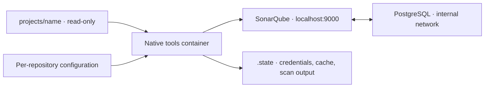

# Local PHP SonarQube package

Clone PHP repositories into `projects/`, run a scan, and open the printed SonarQube dashboard. Each repository has its own private project and analysis history.

The package runs SonarQube Community Build, PostgreSQL, and a native one-shot scanner with Docker Compose. Setup, administrator password rotation, project registration, and scan tokens are automated.

## Requirements

- macOS or Linux, on Intel/AMD64 or ARM64, with a **local** Docker daemon.
- Bash, Git, current Docker with BuildKit-enabled builds, and the Docker Compose v2-or-newer plugin.
- Docker Desktop running on macOS, or Docker Engine running on Linux.
- Recommended: allocate **8 GB RAM**, at least **2 CPUs**, and **30 GB available disk** to Docker. Keep at least 10% of its disk free. Requirements grow with repository size.
- Network access for Docker images, the verified scanner download, and Ubuntu packages during the first tools build.

Using this package requires no host PHP, Composer, PHPUnit, Java, or Python installation. The tools container includes Java and Python; your existing test environment remains responsible for PHPUnit. Python 3.8+ is only needed if you run the maintainer tests locally.

### Linux and Docker VM prerequisites

SonarQube's embedded Elasticsearch requires `vm.max_map_count >= 524288`, `fs.file-max >= 131072`, and suitable process/file limits. Compose supplies `nofile=131072` and `nproc=8192` for the server container. Startup checks the kernel values before starting services. The package does not change kernel settings or disable Elasticsearch bootstrap checks.

Check the Linux Docker host:

```bash
sysctl vm.max_map_count fs.file-max
```

When the current values are below the requirements, set them on that host:

```bash
sudo sysctl -w vm.max_map_count=524288
sudo sysctl -w fs.file-max=131072
```

For persistence across Linux reboots, put those values in `/etc/sysctl.d/99-sonarqube.conf` and apply that file with `sudo sysctl -p /etc/sysctl.d/99-sonarqube.conf`.

On macOS these settings belong to **Docker's Linux VM**. After a first startup attempt has built the tools image, inspect them with:

```bash
SONAR_TOOLS_IMAGE="$(cat .state/stack-name)-tools"
docker run --rm --entrypoint python3 "$SONAR_TOOLS_IMAGE" \
  -c 'from pathlib import Path; print(Path("/proc/sys/vm/max_map_count").read_text()); print(Path("/proc/sys/fs/file-max").read_text())'
```

If needed, set the VM's map count explicitly using a temporary privileged container:

```bash
docker run --rm --privileged --user 0:0 --entrypoint python3 "$SONAR_TOOLS_IMAGE" \
  -c 'from pathlib import Path; Path("/proc/sys/vm/max_map_count").write_text("524288\n")'
```

Docker Desktop may reset this setting after restarting its VM, including an idle VM restart through Resource Saver. Record the original value before changing it. See the [SonarQube host requirements](https://docs.sonarsource.com/sonarqube-community-build/server-installation/server-host-requirements) and [Linux prerequisites](https://docs.sonarsource.com/sonarqube-community-build/server-installation/pre-installation/linux).

## Quick start

Run these commands from this package folder:

```bash
git clone <repository-url> projects/my-app
./sonar scan my-app
./sonar credentials
```

The first scan builds the native tools image, downloads the pinned server/database images, starts the stack, and waits for SonarQube. It then creates a private project, scans the current working tree, waits for server processing, and prints the results URL and quality gate status.

Open [http://localhost:9000](http://localhost:9000) and sign in using the generated login shown by `./sonar credentials`. The initial `admin/admin` password is replaced automatically. The UI is bound to the local machine's loopback interface.

Repository folders must start with a letter or digit and contain only letters, digits, dots, underscores, or dashes. The package accepts up to 200 characters. Match the folder's capitalization exactly when scanning. Folder names determine project keys: `my-app` becomes `local:my-app`. Renaming a folder creates a different project/history.

Scans use the current local checkout, including uncommitted edits. The package preserves Git metadata and does not pull or switch branches. Community Build gives each project one analysis timeline; scanning another checkout updates that same timeline. [Edition comparison](https://docs.sonarsource.com/sonarqube-community-build/feature-comparison-table)

## Commands

| Command | Behavior |
| --- | --- |
| `./sonar up` | Start and initialize the stack without scanning. |
| `./sonar scan my-app` | Analyze one repository and report its gate status. |
| `./sonar scan --all` | Analyze every repository sequentially. |
| `./sonar scan my-app --check-gate` | Analyze, then fail the command if the gate does not pass. |
| `./sonar scan --all --check-gate` | Apply gate enforcement to every repository. |
| `./sonar report my-app` | Export the latest completed analysis as an HTML summary and CSV findings. |
| `./sonar status` | Show Compose services and server readiness. |
| `./sonar logs` | Show the latest 100 service log lines. |
| `./sonar logs sonarqube` | Show only SonarQube logs. `postgres` also works. |
| `./sonar credentials` | Display the generated local UI username and password. |
| `./sonar down` | Remove service containers while preserving data volumes and local state. |
| `./sonar reset --yes` | Remove this installation's containers, volumes, and generated state; preserve repositories/configuration. |
| `./sonar help` | Show command help. |

Exit statuses: `0` means completed successfully; `1` means a configuration, scanner, or server error; `2` means a completed analysis failed gate enforcement. A failed gate still publishes results. Without `--check-gate`, gate failure is informational. For `--all`, runtime errors in one project do not prevent the remaining projects from scanning; any runtime error takes precedence over gate failures.

Operations are serialized. If another command is running, finish it before starting a new one. Stale locks with a dead owner are recovered automatically.

### Downloadable reports

```bash
./sonar report my-app
```

The command prints the path to `.state/reports/my-app/<export-id>/index.html`. Open this file in your browser to view or print it to PDF. The folder also contains `issues.csv` with all issues and `security-hotspots.csv` with all security hotspots. Keep the three files together when sharing the report; the HTML links to the CSV files. Exports are self-contained and use no external scripts, fonts, or styles. Links back to the dashboard and individual findings require the running local server and login.

The HTML includes analysis date/ID, quality gate conditions, code metrics, severity counts, and the first 100 issues ordered by severity. CSV files include rule, file, line, status, message, and review information. Security hotspots are listed separately because they require review rather than necessarily representing confirmed vulnerabilities. Spreadsheet formulas in CSV cells are escaped.

Reports read current server findings for the latest completed analysis, including resolved issues returned by the API and current review states. They do not scan repositories, run tests, create projects, or rotate tokens. SonarQube must already be running; use `./sonar up` if it is stopped. A local repository/configuration is not required to export an existing project. Large result sets are fetched by component to work around the API's 10,000-result search limit. Incomplete exports, changing counts, or an analysis completing during export cause an error instead of a silently truncated report. Avoid changing issue states while exporting; the API does not provide a transactional snapshot.

Exports use the existing local admin credentials without including them or source contents in the report. Findings can still contain sensitive file paths and messages, so review them before sharing. Files are ignored by Git and have restricted permissions. `./sonar reset --yes` deletes exports along with other package state; copy any reports you want to keep elsewhere first. Built-in PDF reports are an Enterprise Edition feature; this package generates its own HTML/CSV report using the Community Build Web API.

### Port and timeouts

```bash
SONAR_PORT=9001 ./sonar scan my-app
SONAR_STARTUP_TIMEOUT=600 SONAR_ANALYSIS_TIMEOUT=600 ./sonar scan --all
```

| Variable | Default | Purpose |
| --- | --- | --- |
| `SONAR_PORT` | `9000` | Local UI port. Use the same value for subsequent commands. |
| `SONAR_STARTUP_TIMEOUT` | `300` | Seconds to wait for server readiness. |
| `SONAR_ANALYSIS_TIMEOUT` | `300` | Seconds to wait for each uploaded analysis and gate computation. |
| `SONAR_SCAN_TIMEOUT` | `1800` | Seconds allowed for each scanner process. |
| `SONAR_REPORT_TIMEOUT` | `600` | Seconds allowed for the complete report export. |

Use the `./sonar` wrapper for normal operation. It selects an installation-specific Compose project and loads generated database credentials. Plain `docker compose up` uses a different project name and does not initialize those credentials.

## Repository configuration

Generic defaults scan PHP files throughout the repository, including `.php`, `.php3`, `.php4`, `.php5`, `.phtml`, `.inc`, and `php.ini`. Dependencies and generated directories named `vendor`, `node_modules`, `.git`, `.scannerwork`, `coverage`, `build`, and `dist` are excluded. SonarQube's default PHP quality profile and quality gate remain in use.

For repository-specific settings, create `config/projects/<folder-name>.properties`:

```bash
cp config/examples/php.properties config/projects/my-app.properties
```

For example:

```properties
sonar.sources=src
sonar.tests=tests
sonar.php.version=8.3
```

Paths are relative to the repository root and must exist inside that repository. `sonar.sources` and `sonar.tests` accept comma-separated paths, not wildcard directory patterns. When test paths are configured, the package excludes them from the production source set. For `sonar.tests=.`, configure `sonar.test.inclusions` to distinguish tests.

Overrides replace the matching default property. If you customize `sonar.exclusions`, retain any default exclusions your repository still needs. Configuration uses UTF-8 Java properties syntax, including escaped separators and continued lines.

The package reads its external configuration; an existing `sonar-project.properties` inside a clone is not loaded automatically. Project identity, server connection, credentials, working directory, branch/PR settings, and scanner connection settings are controlled by the package. Overrides that attempt to change them fail explicitly.

Local per-repository overrides, clones, and generated state are Git-ignored. The reusable examples and package defaults are tracked.

### WordPress

```bash
cp config/examples/wordpress.properties config/projects/my-site.properties
```

Replace the sample source paths with the themes/plugins your team owns:

```properties
sonar.sources=wp-content/themes/my-theme,wp-content/plugins/my-plugin
```

This limits analysis to those directories, excluding WordPress core and third-party themes/plugins through source selection. Ownership is chosen explicitly rather than inferred. For a standalone theme/plugin repository, use `sonar.sources=.`.

### Existing test and coverage reports

SonarQube analyzes code and imports reports; this package does not install project dependencies or run PHPUnit. Generate reports in your existing test environment first, using repository-relative file references or paths matching the scanner's `/projects/<name>/` mount.

```properties
sonar.php.coverage.reportPaths=coverage/clover.xml
sonar.php.tests.reportPath=coverage/junit.xml
```

Coverage reports must use Clover XML; test execution reports must use PHPUnit's JUnit XML. Reports are imported only when configured, and configured report files must exist inside the repository. Host absolute paths embedded in reports need to be adjusted in the report-generation environment. [SonarQube PHP coverage documentation](https://docs.sonarsource.com/sonarqube-community-build/analyzing-source-code/test-coverage/php-test-coverage)

The default Sonar Way gate includes coverage expectations for new code. A static-only scan can therefore report a failed gate; the normal scan command still succeeds when analysis and publication complete.

## Data and architecture



PostgreSQL data and SonarQube data, logs, and extensions use named Docker volumes. Cloned sources and configuration are mounted read-only. Each scan has a separate working directory under `.state/scans/`, and gate status is checked against the submitted task's exact analysis ID.

Generated secrets are held under `.state/` with directory mode `0700` and secret-file mode `0600`. Normal setup and scan logs redact stored credentials; only the explicit `credentials` command displays the UI password. Revoked/expired project tokens are replaced on the next scan, while valid tokens are reused.

Keep `.state/` and the matching Docker volumes together when backing up or moving an installation. `.state/stack-name` records its Compose namespace. Losing state while retaining the database loses the generated credentials; restore matching state or intentionally reset the installation.

Pinned components:

| Component | Version |
| --- | --- |
| SonarQube Community Build | `26.9.0.129388-community`, pinned multi-architecture digest |
| PostgreSQL | `17.11-bookworm`, pinned multi-architecture digest |
| Tools base | Eclipse Temurin Java 21, Ubuntu Noble, pinned multi-architecture digest |
| SonarScanner CLI | `8.1.0.6389`, architecture-independent distribution with SHA-256 verification |

The tools Dockerfile adds Git and Python from Ubuntu's repositories. Java, Python, and scanning run natively inside the selected architecture's container. Image/version updates are explicit maintainer changes, rather than automatic runtime upgrades.

## Troubleshooting

- **Docker is not running:** start Docker Desktop or Docker Engine and retry.
- **Startup timeout:** run `./sonar logs`. Check Docker RAM/disk, Elasticsearch kernel limits, and matching state/database credentials. A longer timeout helps slow first startups.
- **Port already allocated:** choose another `SONAR_PORT` and use it consistently.
- **No PHP files selected:** check `sonar.sources`, inclusions, and exclusions. Replace WordPress template placeholders with real owned directories.
- **Missing coverage/test report:** generate it before scanning, or remove the optional report property.
- **Source/cache permission error:** ensure the local user can read the repository. Tools run as the invoking user's UID/GID; scanner writes go to `.state/`.
- **Administrator password changed through the UI:** update `admin_password` in `.state/credentials.json` to match, preserving the rest of the file and its permissions, or restore matching state.
- **Processing timeout:** publication may already have completed. Check the dashboard and logs; increase `SONAR_ANALYSIS_TIMEOUT` for future scans.
- **Interrupted command:** retry it. Saved password changes and orphaned tokens are recovered without resetting project history.
- **Lock has no owner:** once you have confirmed no package command is running, remove `.state/lock` and retry.

## Maintainer validation

Syntax/configuration and standard-library unit tests:

```bash
bash -n sonar
docker compose --profile tools config --quiet
python3 -m unittest discover -s tests -v
```

Run the real Docker smoke suite after satisfying the host prerequisites:

```bash
python3 tests/smoke.py
```

The suite copies the package into an isolated temporary folder, uses its own local port and Compose namespace, and creates three committed fixture repositories. It verifies private projects, coverage/test imports, exclusions, gate modes, token recovery, persistent history across restart, unchanged source/Git files, and reset preservation. It deletes its own volumes/state afterward. If cleanup fails, it preserves and reports the temporary workspace so cleanup can be retried.

For release validation, run this suite on native macOS ARM64 and native Linux AMD64. The GitHub workflow runs the native Linux checks when the repository is hosted there.
